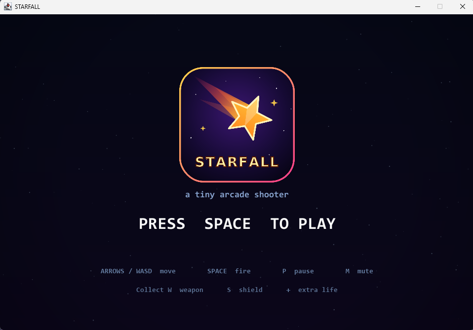

# STARFALL

A complete little arcade shooter written in plain Java. No downloads, no
libraries, no build tools — just Java itself.



---

## Play it in 10 seconds

**Double-click `run.bat`.**

That's it. It compiles the game the first time (a few seconds) and then opens
the game window.

If you prefer a window that shows the compiler messages, use
**`run-console.bat`** instead.

Once the window is open:

| Key | Action |
| --- | --- |
| `SPACE` / `ENTER` | Start the game |
| Arrow keys or `WASD` | Move your ship |
| `SPACE` (hold) | Fire |
| `P` | Pause / resume |
| `ESC` | Quit to the title screen (or from pause) |
| `M` | Mute / unmute the sound |

## How to play

Enemies fall from the top. Shoot them, don't get hit.

- **Drifter** (pink) — slow, wobbles as it falls. 10 points.
- **Zigzag** (orange) — spins and sweeps side to side, takes 2 hits or more. 25 points.
- **Tank** (purple) — big and tough, fires aimed shots at you. 60 points.

Enemy shots are the pink glowing dots. Touching an enemy also hurts.

You start with **3 lives** and **1.5 seconds of invulnerability**. After you
take a hit you get 2 more seconds of invulnerability, so you can escape.

You have **3 gun levels** plus a 4th maxed level. Dying knocks it down one.

### Power-ups

Some enemies drop a floating box when they explode:

| Box | Meaning |
| --- | --- |
| **W** (cyan) | Weapon upgrade |
| **S** (green) | 7-second shield (the next hit is absorbed) |
| **+** (pink) | Extra life (max 5) |

### Difficulty

Every **500 points** you clear a wave and the game gets a little harder:
enemies fall faster, spawn more often, are tougher, and the tanks shoot more.
The game caps the difficulty so it stays playable instead of becoming
impossible.

Your best score is remembered as long as the game window stays open.

---

## Where the code lives

All the Java files are in [`src/starfall/`](src/starfall/). Each file holds
exactly one class, so the compiled output is one clean `.class` file per idea —
there are no `$` files or hidden inner classes to confuse you.

### The game itself

| File | What it does |
| --- | --- |
| [`Main.java`](src/starfall/Main.java) | Entry point. Checks your Java version, then starts the game. |
| [`Launcher.java`](src/starfall/Launcher.java) | Hands window creation to Swing's event thread (a Java requirement). |
| [`SetupWindow.java`](src/starfall/SetupWindow.java) | Friendly instructions if your Java is too old. |
| [`Game.java`](src/starfall/Game.java) | The rules: the 60 FPS loop, spawning, collisions, score, waves, drawing the HUD and menus. |

### Things in the game

| File | What it does |
| --- | --- |
| [`Player.java`](src/starfall/Player.java) | Your ship: movement, limits, shield and invulnerability rings. |
| [`Enemy.java`](src/starfall/Enemy.java) | Looks and moves one enemy. |
| [`EnemyType.java`](src/starfall/EnemyType.java) | `DRIFTER`, `ZIGZAG`, `TANK`. |
| [`Bullet.java`](src/starfall/Bullet.java) | One shot, friendly or enemy. |
| [`Pickup.java`](src/starfall/Pickup.java) | A falling power-up. |
| [`PickupType.java`](src/starfall/PickupType.java) | `WEAPON`, `SHIELD`, `LIFE`. |
| [`Particle.java`](src/starfall/Particle.java) | Explosion sparks. |
| [`Star.java`](src/starfall/Star.java) | The drifting star field in the background. |
| [`GameState.java`](src/starfall/GameState.java) | `TITLE`, `PLAYING`, `PAUSED`, `GAME_OVER`. |

### Plumbing

| File | What it does |
| --- | --- |
| [`GameView.java`](src/starfall/GameView.java) | The panel that gets painted each frame. |
| [`Keyboard.java`](src/starfall/Keyboard.java) | Turns key and mouse events into game input. |
| [`Input.java`](src/starfall/Input.java) | Remembers which keys are held and which were just pressed. |
| [`Key.java`](src/starfall/Key.java) | Named constants for the few keys the game uses. |
| [`Fx.java`](src/starfall/Fx.java) | Glow, colour mixing and gradient text helpers. |

### Pictures

The [images](images/) folder holds the artwork, all PNG with transparency:

| File | Used for |
| --- | --- |
| `Rocketship.png` | Your ship |
| `bullet.png` | Your shots |
| `heart.png` | The remaining-lives icons |
| `Starfall.png` | The logo on the title screen |

Pictures are read once into memory when first needed, then reused every frame.
If a picture is missing, the game draws its built-in shape instead, so it still
runs with an empty `images` folder.

`bullet.png` is a black outline drawing, which would be invisible against the
dark playfield. `Art.drawTinted` recolours it using the picture's transparency,
so it keeps its crisp outline while glowing in the player's colour.

| File | What it does |
| --- | --- |
| [`Art.java`](src/starfall/Art.java) | Loads and caches pictures, scales them, and tints them. |

### Sound

The shooting and pick-up sounds come from the [SFX](SFX/) folder as WAV files.
Everything else is built from a maths function when the game starts, so the
project still works with no audio files at all.

Java can only play **WAV** (MP3 needs a separate decoder library this project
avoids, so the original `.mp3` files are kept only for reference — the game
loads the `.wav` versions).

If you replace a sound, drop a WAV file into `SFX` with the same name. Mono,
16-bit WAV works best. Missing or unreadable files fall back to the built-in
generated sound, so the game never breaks over audio.

| File | What it does |
| --- | --- |
| [`Sound.java`](src/starfall/Sound.java) | Loads the WAV files, plays effects, honours the mute key. |
| [`SoundType.java`](src/starfall/SoundType.java) | `SHOOT`, `HIT`, `EXPLODE`, `PICKUP`, `HURT`, `START`. |
| [`SoundEffect.java`](src/starfall/SoundEffect.java) | Shared base class: turns a wave into a playable audio clip. |
| [`ShotEffect.java`](src/starfall/ShotEffect.java) | Backup "pew" if `SFX/shoot.wav` is missing. |
| [`HitEffect.java`](src/starfall/HitEffect.java) | Click when a shot lands. |
| [`ExplodeEffect.java`](src/starfall/ExplodeEffect.java) | The boom when an enemy dies. |
| [`PickupEffect.java`](src/starfall/PickupEffect.java) | Backup chime if `SFX/pickup.wav` is missing. |
| [`HurtEffect.java`](src/starfall/HurtEffect.java) | Buzz when you take damage. |
| [`StartEffect.java`](src/starfall/StartEffect.java) | Four-note fanfare for a new run or wave. |

Because the shot sound is longer than the gap between shots, `Sound` keeps a
few copies of each clip and plays whichever is free. That lets one gunshot ring
out while the next ones start, instead of chopping the sound off.


## How it runs (for someone new to Java)

Java code is **compiled** (turned into `.class` files by `javac`) and then
**run** (`java` reads those files). That's what `run.bat` does for you:

```
javac -d out -sourcepath src src\starfall\Main.java   ... compile
java  -cp out starfall.Main                           ... run
```

`Game.java` runs a loop 60 times a second. Each pass it:

1. reads the keyboard,
2. moves everything a tiny fraction of a second forward (`dt`),
3. checks for collisions,
4. repaints the window.

Because everything moves by "amount per second × how long the frame took",
the game feels the same on any computer speed.

### Running it from VS Code

The game works from the terminal as shown above, or press **F5** in VS Code
after installing the [Extension Pack for Java](https://marketplace.visualstudio.com/items?itemName=vscjava.vscode-java-pack).
A `Run STARFALL` launch configuration is already set up in [`.vscode/launch.json`](.vscode/launch.json).

## Requirements

- A **JDK** (Java Development Kit) version **8 or newer**.
  If `run.bat` can't find one, it prints the install command:
  `winget install Microsoft.OpenJDK.21`
- Windows, macOS or Linux, with a screen. No internet needed to play.

## Try changing something

A few friendly first experiments:

- **Too hard?** In `Game.java`, change `lives = 3;` to `lives = 5;`.
- **Want faster shooting?** In `Player.java`, change `fireCooldown = 0.15;` to `0.08`.
- **Change the title.** In `Game.java`, the string `"STARFALL"` in `drawTitle` is the title text.
- **Make enemies slower.** In `Enemy.java`, lower the `vy` values.
- **Change a sound.** Drop a WAV into `SFX` named `shoot.wav` or `pickup.wav`.
- **Change the artwork.** Replace any PNG in `images` with one of the same name.
  Transparent backgrounds work best.
- **Add a new sound.** Copy `HitEffect.java` to a new file, change the numbers,
  then register it in `Sound.java` and add it to `SoundType.java`.

## A note on controls and focus

If the window loses focus (for example you click another window) while you are
holding a key down, the game releases that key for you. Without this, the ship
would keep drifting because the key release never arrives.
